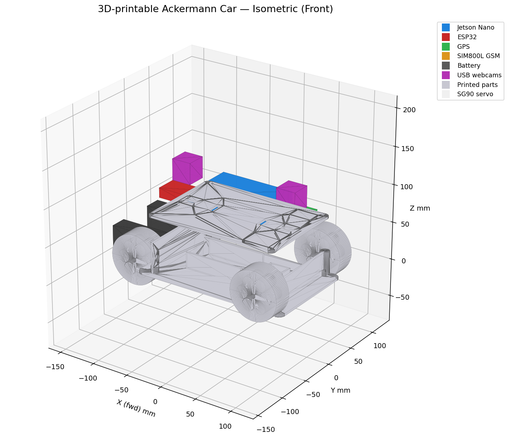
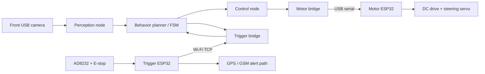

# Driver-Awareness Emergency-Response Vehicle

A ROS 2 and ESP32 prototype that combines driver-state sensing, lane perception, autonomous pull-over behavior, emergency stopping, and a parametric vehicle chassis.



[Watch the simulation clip](media/simulation.mp4)

## What this project demonstrates

- A six-node ROS 2 stack for camera capture, perception, behavior planning, lateral/longitudinal control, and hardware bridges
- Classical lane detection using HLS color masks, Canny edges, sliding-window polynomial fitting, confidence scoring, and debouncing
- Optional YOLO obstacle detection without committing third-party model weights to the repository
- A dwell-gated finite-state machine for lane following, obstacle handling, lane change, pull-over, and parked states
- ESP32 firmware for fail-safe driver monitoring and low-level drive/steering control
- A reproducible simulation harness that exercises the real planner, controller, perception, and motor-bridge code without a ROS installation
- Parametric CadQuery source plus STEP and STL exports for a 3D-printable Ackermann-steering chassis

## System architecture



The normal behavior path is:

`HOLD → LANE_FOLLOW → CHANGE_LANE_RIGHT or SLOW_FOR_OBSTACLE → SEARCH_PARK → PULL_OVER → PARKED`

## Safety-oriented design

- Emergency-stop and communication-loss events force `HOLD` and require an explicit re-arm.
- Lane, obstacle, and blind-spot signals are debounced before they affect the planner.
- Minimum state dwell and transition cooldowns reduce mode chatter.
- The motor bridge and ESP32 each have independent stale-command watchdogs.
- A lost lane reduces steering authority instead of allowing a stale correction to grow.
- Brake, parked-state, and emergency-stop overrides remain independent of the normal control path.

This is an academic prototype, not a road-certified safety system.

## Validation

The current portfolio snapshot passes **63/63 simulation assertions** across 15 scenarios, including emergency stop, link loss, lane loss, blind-spot blocking, perception debouncing, state-transition gating, motor watchdog behavior, and PID/pure-pursuit steering direction.

```powershell
python -m pip install -r requirements-dev.txt
$env:PYTHONPATH = "sim;jetson_driver"
python sim\sim_runner.py
```

Linux/macOS:

```bash
python3 -m pip install -r requirements-dev.txt
PYTHONPATH=sim:jetson_driver python3 sim/sim_runner.py
```

See [docs/VALIDATION.md](docs/VALIDATION.md) for the scenario matrix and the hardware checks that simulation cannot replace.

## ROS 2 package

Target platform: Ubuntu 22.04, ROS 2 Humble, and NVIDIA Jetson Orin Nano.

```bash
mkdir -p ~/jetson_ws/src
cp -r jetson_driver ~/jetson_ws/src/
cd ~/jetson_ws
colcon build --packages-select jetson_driver
source install/setup.bash
ros2 launch jetson_driver jetson_driver.launch.py
```

The launch file starts:

1. `camera_node`
2. `perception_node`
3. `planner_node`
4. `control_node`
5. `motor_bridge_node`
6. `trigger_bridge_node`

Hardware-specific values live in `jetson_driver/config/driver_params.yaml` and should be bench-tuned before use.

## Firmware and configuration

- `firmware/motor_esp/motor_esp.ino` maps `TS <drive> <steer>` commands to one DC drive motor and a steering servo.
- `firmware/trigger_esp/trigger_esp.ino` handles the AD8232 input, latching emergency stop, trigger link, and GPS/GSM alert path.

The public copy contains placeholders for Wi-Fi credentials, Jetson IP, and alert phone number. Set them locally before flashing and do not commit real values.

## CAD

The `cad/` folder contains editable CadQuery source, preview renders, STEP files for CAD tools such as SolidWorks, and STL files for slicing. The design uses a 170 mm wheelbase, 140 mm track, and a two-deck electronics layout.

## Repository layout

```text
├── jetson_driver/       ROS 2 package, launch file, and parameters
├── sim/                 ROS shim and 15-scenario validation harness
├── firmware/            motor and driver-awareness ESP32 firmware
├── cad/                 parametric source, STEP/STL exports, previews
├── docs/                validation notes and hardware limitations
└── media/               short simulation clip
```

## Known limitations

- Camera thresholds still require tuning for the real track and lighting.
- YOLO latency and thermal behavior must be measured on the target Jetson.
- Motor breakaway PWM, servo end stops, and steering linkage backlash are hardware-specific.
- Cellular and GPS alert reliability depends on antenna placement, power integrity, and network coverage.
- The included simulation verifies software behavior, not vehicle-level functional safety.

## License

The software and firmware are released under the MIT License. The CAD bundle retains the CC0/public-domain notice in `cad/README.md`.
